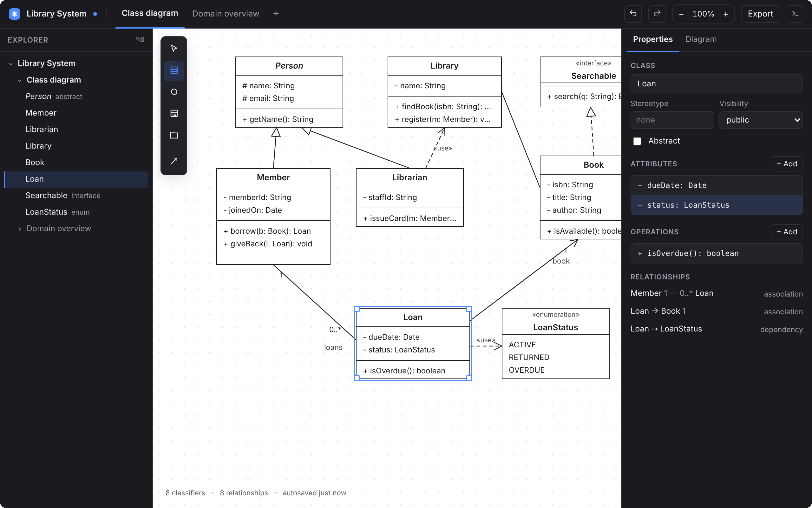

# Aster

Aster is a free, open-source UML class modeller that runs in the browser, keeps everything on your machine, and reads and writes StarUML's `.mdj` format, so a class can switch to it mid-semester without losing a single file.

Draw a class diagram with the keyboard or the mouse, type members as UML text, save the `.mdj` and hand it to a StarUML user, or export a sharp PNG for a report. Nothing leaves your computer: no account, no telemetry, autosave in the browser and files on disk.

## Using it

- **Open a `.mdj`.** `⌘O`, or drop the file anywhere on the window. Every class appears where StarUML left it; diagrams Aster cannot show yet are kept and saved back unchanged.
- **Do the exercise.** `C` makes a class under the pointer with its name selected; `↩` opens the first attribute line; type `- balance: Money = 0`; `Tab` moves to operations; `Esc` ends. `L` links the selected class to another, `1`–`6` pick the relationship kind. Double-click any line to edit it in place.
- **Save.** `⌘S` writes back to the file you opened (`.mdj` or Aster's own `.aster`); `⌘⇧S` saves a copy. The browser keeps an autosave with your undo history either way.
- **Export.** `⌘⇧E` opens the export sheet: PNG at 1× or 2×, SVG with the font embedded, white or transparent, the whole diagram or the selection; `⌘⇧C` copies a PNG to the clipboard.

Press `?` at any time for every shortcut, `⌘K` for every command.

## Keyboard essentials

| Key                            | Action                                                                                           |
| ------------------------------ | ------------------------------------------------------------------------------------------------ |
| `C` `I` `E` `D` `N`            | New class, interface, enumeration, data type, note                                               |
| `L`, then arrows, `↩`, `1`–`6` | Link the selection: pick the target, then the kind                                               |
| `F2` or `↩`                    | Edit the selected name or line                                                                   |
| `⌘↩` / `⌘⇧↩`                   | Add an attribute / operation below (StarUML's keys)                                              |
| `⌫` / `⌘⌫`                     | Remove from the diagram / delete from the model                                                  |
| `⌘E` / `⌘D`                    | Select in Outline / select in diagram                                                            |
| `⌘Z` / `⌘⇧Z`                   | Undo / redo                                                                                      |
| `⌘⇧V Y M J N`, `⌘⇧A O T`       | Show visibility, type, multiplicity, signature, namespace; hide attributes, operations, literals |
| `⌘K`, `?`                      | Command palette, shortcut sheet                                                                  |

`⌘` is `Ctrl` on Windows and Linux. The full table is [`docs/spec/keyboard.md`](docs/spec/keyboard.md).

## StarUML compatibility

Aster opens StarUML 4 to 7 files, keeps every `_id`, and preserves what it does not model (sequence diagrams, profiles, tags, colours) so a file goes back to StarUML unchanged apart from your edits. The golden test round-trips fifteen public `.mdj` files to equality. Feature by feature parity, including what is deliberately different, is in [`docs/spec/parity.md`](docs/spec/parity.md); the native `.aster` format and the save-back rules are in [`docs/file-format.md`](docs/file-format.md).

## Roadmap

From [`docs/spec/overview.md`](docs/spec/overview.md) and [`docs/spec/milestones.md`](docs/spec/milestones.md):

| Milestone                   | Dates          | Scope                                                                                                                                                                                                                                                                                                                          |
| --------------------------- | -------------- | ------------------------------------------------------------------------------------------------------------------------------------------------------------------------------------------------------------------------------------------------------------------------------------------------------------------------------ |
| **M1 · Lab preview**        | 17–24 Oct 2026 | Model and command stack; class, interface, enum, data type nodes; inline UML text editing; six relationships with line styles; notes and documentation; display toggles; `.mdj` import and export; PNG/SVG; autosave and files; undo; Modern layout, light and dark; command palette; explorer as a read-only tree             |
| **M2 · Accessible preview** | 25 Oct–7 Nov   | Outline tree as a full editing surface; Text view with PlantUML round-trip and `.puml` import/export; canvas keyboard navigation and focus model; live announcements; high-contrast theme and reduced motion; pointer targets and drag alternatives; Classic layout; validation panel; quick find; i18n scaffolding; axe in CI |
| **M3 · v0.1 release**       | 8–21 Nov       | Packages with containment; object diagrams; ELK auto-layout and tidy tools; Mermaid and PDF export; fragment import; fill and line colour; PWA offline; performance pass to 500/800; docs site, keyboard reference, template gallery; contributor guide; licence                                                               |

Each is the same model plus a renderer and a text dialect.

- v0.2: use case and package diagrams; XMI 2.x export; templates gallery; editable tags, constraints, association classes, qualifiers, templates; stereotype icon display (lollipops); HTML docs; minimap; CLI export.
- v0.3: sequence and state machine diagrams; `.mdj` fragments export; PlantUML sequence dialect.
- v0.4: activity, component and deployment diagrams; code generation plug-ins (TypeScript, Java, Python skeletons).
- v0.5: real-time collaboration over a self-hostable relay; comments; version history.
- Not planned: accounts as a requirement, cloud-only storage, telemetry, a mobile authoring layout (viewing on mobile is in scope from v0.2), SysML/ERD/BPMN and the other non-UML notations.

## Contributing

See [`CONTRIBUTING.md`](CONTRIBUTING.md) for setup, the tests, and the rules that keep the model the single source of truth and the app accessible. The specification is in [`docs/spec/`](docs/spec/); every deviation from it is one line in [`DECISIONS.md`](DECISIONS.md). Found a `.mdj` that does not round-trip? Open a compatibility report and attach the file.

## Licence

MIT. See [`LICENSE`](LICENSE). The bundled Source Sans 3 font is under the SIL Open Font License (`src/lib/assets/fonts/source-sans-3/OFL.txt`); the public `.mdj` fixtures keep their own licences (`fixtures/mdj/SOURCES.md`).
