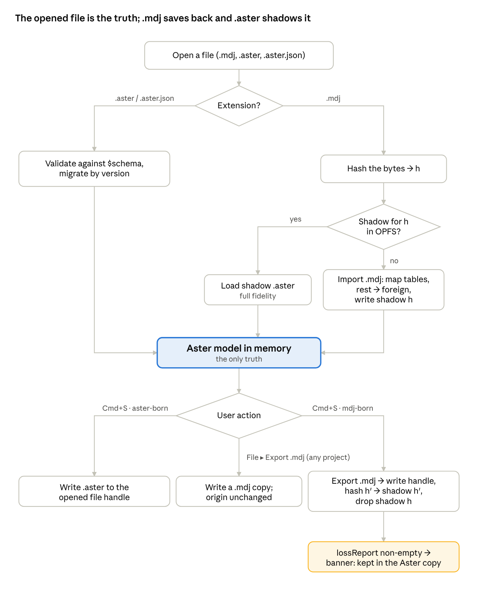

# Aster file format and `.mdj` save-back

The in-memory `Project` (`src/lib/model/types.ts`) is the only truth. `.aster` is that project written to JSON, nothing more; `.mdj` is a codec at the boundary (`src/lib/mdj`), never a second live representation. Decided 18 Oct 2026; lands in the Day 5 slice (`docs/prompts.md`).

## Decisions

| Rule             | Decision                                                                                                                                                                                                                                                                                                           |
| ---------------- | ------------------------------------------------------------------------------------------------------------------------------------------------------------------------------------------------------------------------------------------------------------------------------------------------------------------ |
| Native file      | `.aster`: JSON, `$schema`, integer `version`. `.aster.json` is accepted on open, never written.                                                                                                                                                                                                                    |
| What it holds    | The `Project` as is — elements, diagrams with layout, `unknown[]` (including the `#source` records), `importedIds` — plus an `origin` block for mdj-born projects. No new model types; the codec only converts `Map`/`Set` to JSON.                                                                                |
| Schema           | zod types in `src/lib/aster/schema.ts`, mirroring `types.ts` field for field; JSON Schema 2020-12 from `z.toJSONSchema` (zod 4) at build time; the same zod schema validates on open.                                                                                                                              |
| `.mdj` import    | Unchanged: `parseMdj` keeps `_id`s in `importedIds` and everything unmapped in `unknown[]` / `#source`. Mapping table: `docs/spec/data-model.md`.                                                                                                                                                                  |
| `.mdj` export    | Always available (Export sheet), for any project, through `serializeMdj`.                                                                                                                                                                                                                                          |
| Save-back        | `⌘S` writes to whatever was opened. An mdj-born project writes `.mdj`; an aster-born project writes `.aster`. `⌘⇧S` saves a copy, either format.                                                                                                                                                                   |
| Shadow           | There is no separate OPFS shadow. The IndexedDB autosave (Day 5 item 4) already keeps the full project plus undo stack per project (id plus file name); it _is_ the full-fidelity copy of an mdj-born project.                                                                                                     |
| Opened file wins | On `⌘O` of `foo.mdj`: hash the bytes; if an autosaved entry carries the same `origin.sourceHash`, restore it (undo history included); otherwise parse fresh and the stale autosave is replaced. A file edited in StarUML never matches, so its autosave never shadows it.                                          |
| Lossy notice     | `serializeMdj` is lossless for everything `types.ts` models plus `unknown`; `lossReport(project)` is empty in v1 by construction. It exists so the Day 5 save flow has the hook: when non-empty, the save still happens and a banner says what was kept only in the Aster copy, with one action, "Save as .aster". |
| Scope            | Class diagrams at full fidelity; other `.mdj` diagram types ride along in `unknown[]`, greyed out in the Explorer (M2).                                                                                                                                                                                            |

## `.aster` v1

```typescript
// src/lib/aster/schema.ts — zod, mirrors types.ts; shown here as TS for reading
interface AsterFile {
	$schema: 'https://asteruml.app/schema/v1.json';
	version: 1;
	meta?: { app: string; savedAt: string }; // informational only
	origin?: {
		kind: 'staruml';
		sourceHash: string; // sha-256 (hex) of the .mdj bytes last read or written
		fileName?: string;
	};
	project: {
		id: Id;
		name: string;
		elements: Record<Id, Element>; // Project.elements (Map) → object keyed by id, insertion order kept
		diagrams: Array<Omit<Diagram, 'layout'> & { layout: Record<Id, Layout> }>;
		unknown: Unknown[]; // verbatim, #source records included
		importedIds: Id[]; // Set → array
	};
}
```

Rules:

- `Map` → object keyed by id in insertion order; `Set` → array; `undefined` fields are dropped; nothing else is transformed. `parseAster` is the exact inverse, so `parseAster(serializeAster(p))` is structurally equal to `p` (the undo property test's equality).
- `version` is read before anything else. v1 has no migrations; `migrate(version, json)` is a switch with one case so v2 has somewhere to go.
- The zod schema is strict (`.strict()` objects): an unknown key is a validation error, not silent data loss. Validation errors on open list the JSON path, never a stack trace (board 22's "Show details").
- `$schema` is written for editors and ignored on read.

Why not a nested, prettier format: the file is a save format first and a diff target second. Mirroring `types.ts` means one place to change when the model changes, and a `git diff` of an `.aster` shows the element that changed, nothing more.

## Open, save and export



The picture was drawn before the shadow became the autosave; read "OPFS shadow" as "autosave entry for this project id".

**Open.** `pickFile` accepts `.mdj`, `.aster` and `.aster.json`. By extension: `.aster` → `parseAster` (validate, migrate, load); `.mdj` → hash, autosave lookup, then `parseInWorker` on a miss. Both end in `projectStore.load`. `files.current` keeps the handle and the format it was opened as.

**Save.** `⌘S` → `files.current.format` decides the writer: `serializeMdj` or `serializeAster`. For `.mdj`, hash the written bytes and store the hash as `origin.sourceHash` in the autosave entry, so the next `⌘O` of that file matches. Without File System Access, both formats fall back to download.

**Export.** The Export sheet (board 06) offers PNG, SVG, `.mdj` and `.aster`; the file-format rows are plain downloads through the same two serializers and never change `files.current`.

**Autosave.** The Day 5 autosave stores `serializeAster(project)` plus `stack.snapshot()`, keyed by project id plus file name (StarUML template files share one id; `DECISIONS.md`). One serializer, two destinations; the autosave entry is readable as an `.aster` file, which is what makes it the shadow.

**Later (M3, PWA).** `file_handlers` in the manifest for `.aster` and `.mdj`; `.aster` icons from `docs/brand/`.

## Where it lands in the code

| Piece                                                                                                       | Lives in                                                                 | Slice                                     |
| ----------------------------------------------------------------------------------------------------------- | ------------------------------------------------------------------------ | ----------------------------------------- |
| `serializeAster`, `parseAster`, `migrate`, `lossReport`                                                     | `src/lib/aster/` (sibling of `src/lib/mdj/`)                             | Day 5                                     |
| zod schema + JSON Schema build step                                                                         | `src/lib/aster/schema.ts`, `scripts/schema.ts` → `static/schema/v1.json` | Day 5 (zod), schema publish after the lab |
| Open by extension, save by format, hash and autosave match                                                  | `src/lib/persist/files.svelte.ts`, `src/lib/persist/autosave.svelte.ts`  | Day 5                                     |
| Round-trip test: `parseAster(serializeAster(p))` equals `p` for every fixture and the undo-property project | `tests/unit/aster.test.ts`                                               | Day 5                                     |
| Export sheet rows for `.mdj` and `.aster`                                                                   | Export dialog                                                            | Day 5                                     |
| Greyed-out unknown diagrams in the Explorer                                                                 | Explorer                                                                 | M2                                        |
